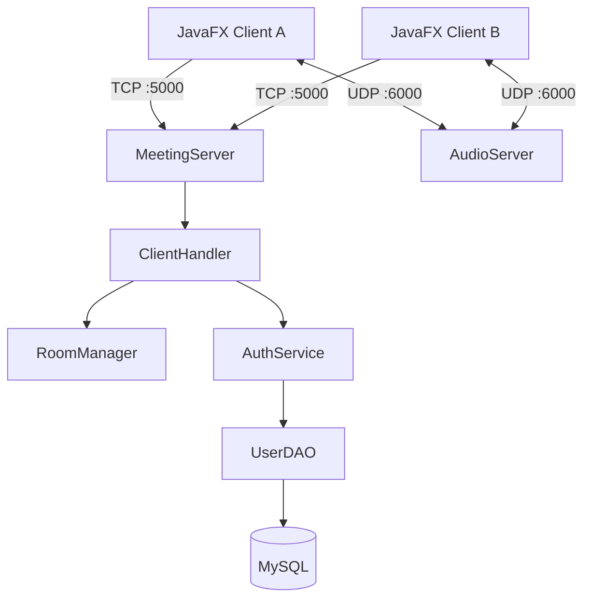

<div align="center">

# 🎥 OnlineMeeting

### Ứng dụng họp trực tuyến với JavaFX & TCP/UDP Socket

**Java 21 · JavaFX 21 · TCP/UDP · MySQL · Maven**

[](https://openjdk.org/)
[](https://openjfx.io/)
[](https://maven.apache.org/)
[](https://www.mysql.com/)

**[Source code](https://github.com/qucank2006/OnlineMeeting)** · **[Báo lỗi / Đề xuất](https://github.com/qucank2006/OnlineMeeting/issues)**

</div>

---

## 📖 Giới thiệu

**OnlineMeeting** là ứng dụng desktop mô phỏng hệ thống họp trực tuyến theo kiến trúc **Client–Server**, được phát triển để thực hành lập trình mạng Java. Dự án kết hợp TCP Socket để xử lý tài khoản, quản lý phòng và tin nhắn, cùng UDP Socket để truyền âm thanh theo thời gian thực.

Ứng dụng được tổ chức thành các thành phần giao diện JavaFX, logic client/server, quản lý phòng và truy cập MySQL. Mục tiêu là hiểu rõ luồng giao tiếp mạng, xử lý nhiều kết nối và quản lý trạng thái của một cuộc họp.

> **Phạm vi phiên bản trên nhánh `main`:** Có đăng ký/đăng nhập, tạo/tham gia/rời phòng, hiển thị thành viên, chat toàn phòng và microphone qua UDP. **Chưa có truyền hình ảnh camera** trong mã nguồn hiện được đưa lên GitHub. README này mô tả phiên bản trong repository, không khẳng định các thay đổi chưa push.

## ✨ Tính năng

| Nhóm | Chức năng | Trạng thái |
|---|---|---|
| Tài khoản | Đăng ký với username, email, tên hiển thị và mật khẩu | ✅ Đã có |
| Xác thực | Đăng nhập bằng username hoặc email; xác thực phía server | ✅ Đã có |
| Mật khẩu | Lưu mật khẩu dạng hash bằng BCrypt | ✅ Đã có |
| Phòng họp | Tạo phòng với mã 6 ký tự, tham gia bằng Room ID, rời phòng | ✅ Đã có |
| Thành viên | Cập nhật danh sách, thông báo tham gia/rời phòng | ✅ Đã có |
| Chat | Nhắn tin chung trong phòng qua TCP | ✅ Đã có |
| Audio | Thu/phát PCM và chuyển tiếp âm thanh qua UDP | ✅ Đã có |
| Microphone | Bật/tắt micro trong cuộc họp | ✅ Đã có |
| Camera | Truyền video thời gian thực | 🚧 Chưa có trên `main` |
| Chia sẻ màn hình | Screen sharing | 📌 Dự kiến |

## 🧰 Công nghệ

| Thành phần | Công nghệ | Vai trò |
|---|---|---|
| Ngôn ngữ | Java 21 | Client và server |
| Giao diện | JavaFX 21.0.6, FXML | Ứng dụng desktop |
| Quản lý phụ thuộc | Maven, Maven Wrapper | Build và chạy ứng dụng |
| Kênh điều khiển | Java TCP Socket | Đăng ký, đăng nhập, phòng và chat |
| Truyền âm thanh | Java UDP Socket, Java Sound API | Audio PCM realtime |
| Cơ sở dữ liệu | MySQL, Connector/J 9.5.0 | Lưu tài khoản |
| Bảo vệ mật khẩu | jBCrypt 0.4 | Băm và xác thực mật khẩu |
| Xử lý đồng thời | Java Threads | Phục vụ client và audio |

## 🏗 Kiến trúc



- **TCP / port 5000:** gửi yêu cầu và phản hồi đăng ký, đăng nhập, tạo/tham gia/rời phòng; nhận cập nhật thành viên và tin nhắn.
- **UDP / port 6000:** gửi các gói audio từ client đến server, sau đó server chuyển tiếp đến các địa chỉ UDP đã ghi nhận trong cùng phòng.
- **MySQL:** lưu tài khoản người dùng; phòng họp và lịch sử chat của phiên hiện tại chưa được lưu bền vững.

## 📂 Cấu trúc dự án

```text
OnlineMeeting/
├── .mvn/wrapper/                   # Maven Wrapper
├── mvnw                         # Linux/macOS
├── mvnw.cmd                     # Windows
├── pom.xml
└── src/main/
    ├── java/
    │   ├── module-info.java
    │   └── com/example/onlinemeeting/
    │       ├── client/            # JavaFX entry point, TCPClient, AudioClient
    │       ├── controller/        # Login, Register, Home, Meeting
    │       ├── database/          # DatabaseConnection, UserDAO
    │       ├── model/             # User, Room
    │       ├── server/            # MeetingServer, ClientHandler, RoomManager, AudioServer
    │       ├── service/           # AuthService
    │       └── test/              # Các lớp kiểm tra thủ công
    └── resources/com/example/onlinemeeting/fxml/
        ├── login-view.fxml
        ├── register-view.fxml
        ├── home-view.fxml
        └── meeting-view.fxml
```

## 🚀 Cài đặt & chạy

### 1. Yêu cầu

- **JDK 21** (kiểm tra bằng `java -version`).
- **MySQL Server** đang hoạt động.
- **Git** để clone repository.
- **IntelliJ IDEA** (khuyến nghị) hoặc terminal có thể chạy Maven Wrapper.
- Microphone, loa/tai nghe để thử audio.

### 2. Lấy mã nguồn

```bash
git clone https://github.com/qucank2006/OnlineMeeting.git
cd OnlineMeeting
```

### 3. Chuẩn bị database

Mã nguồn hiện tại truy vấn bảng `users` với các cột `id`, `username`, `email`, `password_hash`, `display_name`, `created_at`, `updated_at`. Repository **chưa cung cấp file migration/schema SQL**, vì vậy có thể tạo database và bảng tương ứng như sau (schema mẫu tương thích với các câu SQL trong `UserDAO`):

```sql
CREATE DATABASE IF NOT EXISTS online_meeting
    CHARACTER SET utf8mb4 COLLATE utf8mb4_unicode_ci;

USE online_meeting;

CREATE TABLE IF NOT EXISTS users (
    id BIGINT NOT NULL AUTO_INCREMENT PRIMARY KEY,
    username VARCHAR(50) NOT NULL UNIQUE,
    email VARCHAR(255) NOT NULL UNIQUE,
    password_hash VARCHAR(255) NOT NULL,
    display_name VARCHAR(100) NOT NULL,
    created_at TIMESTAMP NOT NULL DEFAULT CURRENT_TIMESTAMP,
    updated_at TIMESTAMP NOT NULL DEFAULT CURRENT_TIMESTAMP
        ON UPDATE CURRENT_TIMESTAMP
);
```

Tạo file **`src/main/resources/database.properties`** trên máy của bạn:

```properties
db.host=localhost
db.port=3306
db.name=online_meeting
db.username=root
db.password=YOUR_MYSQL_PASSWORD
```

> ⚠️ `database.properties` chứa thông tin truy cập database. **Không commit mật khẩu lên GitHub.** Nên thêm file này vào `.gitignore` nếu chưa được bỏ qua. Đây là file cấu hình cần tạo riêng vì không có trong nhánh `main` đang được kiểm tra.

### 4. Khởi động server

Mở project bằng IntelliJ IDEA, chọn JDK 21 và chạy hàm `main()` trong:

```text
src/main/java/com/example/onlinemeeting/server/MeetingServer.java
```

Server mở hai cổng:

| Giao thức | Port | Công dụng |
|---|---:|---|
| TCP | `5000` | Tài khoản, phòng, chat |
| UDP | `6000` | Audio |

### 5. Khởi động client

Chạy JavaFX application bằng Maven Wrapper:

**Windows (PowerShell):**

```powershell
.\mvnw.cmd javafx:run
```

**Linux/macOS:**

```bash
./mvnw javafx:run
```

Hoặc chạy cấu hình JavaFX Maven tương ứng trong IntelliJ. Main class của client là `com.example.onlinemeeting.client.OnlineMeetingApplication`.

> Trong source hiện tại, `LoginController`, `RegisterController` và `MeetingController` dùng địa chỉ server **`localhost`**. Cấu hình mặc định phù hợp để chạy server và client **trên cùng một máy**.

## 🧪 Demo nhanh

1. Chạy MySQL, tiếp theo chạy `MeetingServer`.
2. Mở client, **đăng ký** tài khoản rồi **đăng nhập**.
3. Chọn **Tạo phòng**, lấy mã Room ID.
4. Mở một client khác, đăng nhập bằng tài khoản thứ hai và **Tham gia phòng** bằng mã vừa tạo.
5. Thử nhắn tin, xem thành viên vào/ra, bật/tắt microphone và rời phòng.

**Demo trên hai máy trong LAN:** kết nối hai thiết bị vào cùng mạng, xác định địa chỉ IPv4 máy server bằng `ipconfig` (Windows) hoặc `ip addr` (Linux), thay các địa chỉ `localhost` cố định trong source client bằng IP server, sau đó cho phép **TCP 5000** và **UDP 6000** qua firewall. Nếu dùng MySQL trên máy server, client không cần kết nối MySQL trực tiếp; server thực hiện truy cập database.

## 📡 Giao thức ứng dụng (tóm tắt)

Các message điều khiển được gửi trên một kết nối TCP. Dấu `|` được sử dụng để phân tách trường dữ liệu.

```text
REGISTER|base64(username)|base64(email)|base64(password)|base64(displayName)
LOGIN|base64(identifier)|base64(password)
CREATE_ROOM
JOIN_ROOM|ROOM_ID
LEAVE_ROOM
CHAT|message

REGISTER_SUCCESS
LOGIN_SUCCESS|userId|username|base64(displayName)
ROOM_CREATED|ROOM_ID
JOIN_SUCCESS|ROOM_ID
MEMBERS|user1,user2
USER_JOINED|username
USER_LEFT|username
CHAT|sender|message
```

Trong phần audio, mỗi UDP datagram từ client chứa **1 byte độ dài Room ID**, tiếp theo là **Room ID (UTF-8)** và dữ liệu **PCM audio**. Định dạng audio: **16 kHz, 16-bit, mono, signed PCM, little-endian**.

> Base64 chỉ là **mã hóa biểu diễn dữ liệu**, không phải mã hóa bảo mật. Kết nối TCP/UDP hiện tại chưa tích hợp TLS hoặc cơ chế mã hóa đầu cuối.

## ⚠️ Giới hạn đã biết

- Code trên `main` chưa có camera/video streaming hay screen sharing.
- Chat mới chỉ hoạt động trong phiên; chưa có chức năng lưu và tải lại lịch sử tin nhắn.
- Room ID và trạng thái phòng được giữ trong bộ nhớ server, không được lưu xuống MySQL.
- Chưa có cơ chế mã hóa đường truyền/kiểm soát truy cập ở mức phù hợp để triển khai trên Internet công cộng.
- Client đang dùng `localhost` cố định; muốn demo liên máy cần đổi cấu hình địa chỉ server.
- Chưa được thiết kế và kiểm chứng cho tải lớn hay môi trường production.

## 🗺️ Hướng phát triển

- [x] Đăng ký, đăng nhập bằng tài khoản MySQL
- [x] BCrypt password hashing
- [x] Tạo, tham gia, rời phòng họp
- [x] Danh sách thành viên và chat toàn phòng
- [x] Truyền âm thanh UDP và bật/tắt microphone
- [ ] Camera / video streaming
- [ ] Chia sẻ màn hình
- [ ] Chọn thiết bị audio/video
- [ ] Cấu hình server host/port từ giao diện hoặc file cấu hình
- [ ] Lưu lịch sử chat
- [ ] Cải thiện bảo mật phiên họp và mã hóa đường truyền
- [ ] Kiểm thử tải và xử lý ngắt kết nối nâng cao

## 👨‍💻 Tác giả

**Trần Lê Quốc Anh** · Sinh viên Trường Đại học Công nghệ Thông tin và Truyền thông Việt – Hàn (VKU)

GitHub: [@qucank2006](https://github.com/qucank2006)

---

<div align="center">

*Dự án phục vụ mục đích học tập, nghiên cứu và thực hành môn Lập trình mạng.*

</div>
